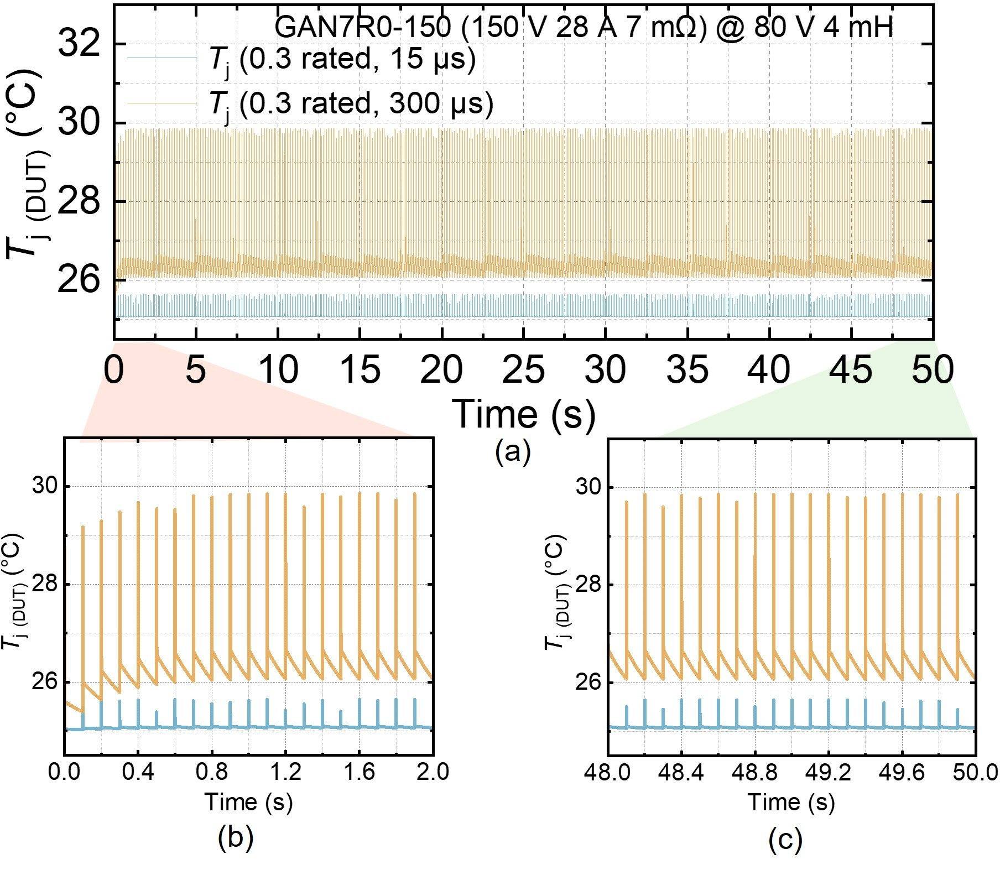
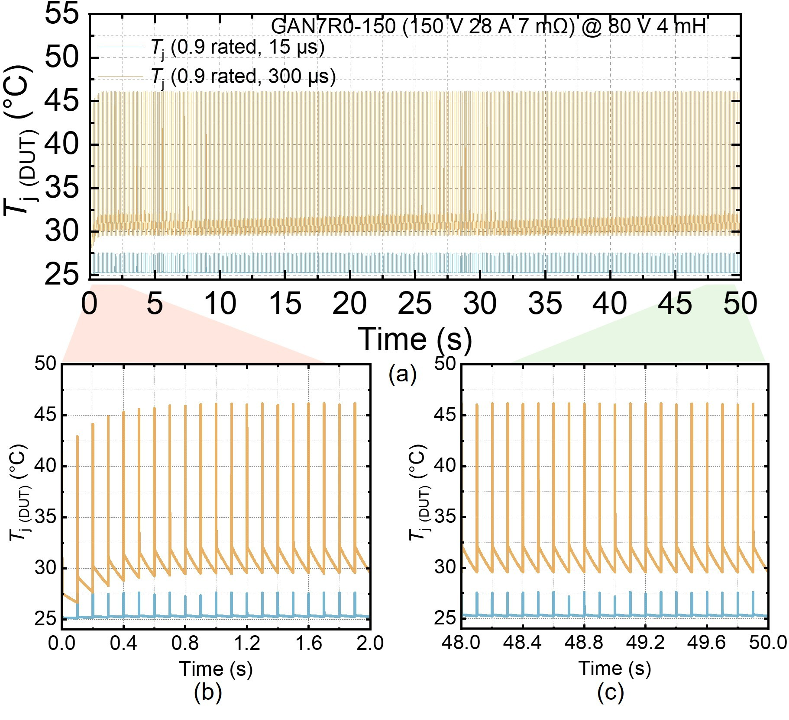

# ltspice-data-reducer

Shrink large LTspice transient exports (hundreds of MB) into files that open instantly in Excel, Origin, MATLAB or Python.

Long electro-thermal or multi-pulse simulations need fine time steps, so exported `.txt` files easily exceed 300 MB and millions of rows. Excel stops at 1,048,576 rows and plotting tools stall or crash. This script reduces each file by around 40 times in seconds, so the results can be plotted and analysed directly.

## Real example

A 50 s repetitive-pulse electro-thermal simulation of a 150 V GaN HEMT: four LTspice exports of 250 to 370 MB each, too large to plot. After reduction (6 to 9 MB each) they plot directly in Origin, both the full 50 s and zoomed windows.





## Modes

| Mode | What it keeps | Use it for |
|---|---|---|
| `skip` (default) | every N-th row | smooth signals, general plotting and analysis |
| `minmax` | the rows holding the min and max of every signal in each block of N rows | anything with sharp features: junction temperature peaks, switching edges, overshoot, ringing |

Both modes:
- keep only original simulation points (no interpolation or averaging)
- always keep the first and last row of every `.step` run, and keep the `Step Information` lines
- stream the file line by line, so memory use stays small
- print a **peak check** that compares every local peak before and after reduction, and warns if `skip` has clipped them

## Usage

Requires Python 3.8 or newer. No extra packages.

```bash
python ltspice_reduce.py "Tj 0.3 rated 15 us.txt"            # skip mode, N = 20
python ltspice_reduce.py "Tj 0.3 rated 15 us.txt" -n 40       # skip mode, N = 40
python ltspice_reduce.py "Tj 0.3 rated 15 us.txt" --mode minmax -n 40
python ltspice_reduce.py "C:\path\to\LTSPICE pulses" -n 40    # every .txt in a folder
```

Output is written next to the input as `<name>_skip40.txt` or `<name>_minmax40.txt`. Files already produced by the script are skipped on reruns.

## Example console output

```
pulses.txt  ->  pulses_skip40.txt
  rows 80,889 -> 2,024   size 2.6 MB -> 0.06 MB  (2.5 %)   0.2 s
  peak check (original vs reduced):
    V(tj)   max 27.6432 vs 27.6405   min 25 vs 25   <- local peaks clipped by up to 72.3 % of range, try --mode minmax

pulses.txt  ->  pulses_minmax40.txt
  rows 80,889 -> 3,212   size 2.6 MB -> 0.10 MB  (4.0 %)   0.2 s
  peak check (original vs reduced):
    V(tj)   max 27.6432 vs 27.6432   min 25 vs 25
```

For short pulses, `skip` can land between samples and under-read individual peaks. `minmax` keeps every peak exactly for about 1.5 times the file size.

## Exporting from LTspice

In the waveform viewer: **File > Export data as text**, select the traces, keep the default tab-separated format. Transient results only (AC complex data is not supported).

## Author

[Xinzhi (Berry) Liu](https://berryliu202.github.io), University of Warwick. Developed while processing electro-thermal simulations for GaN power device reliability work.

## License

MIT
